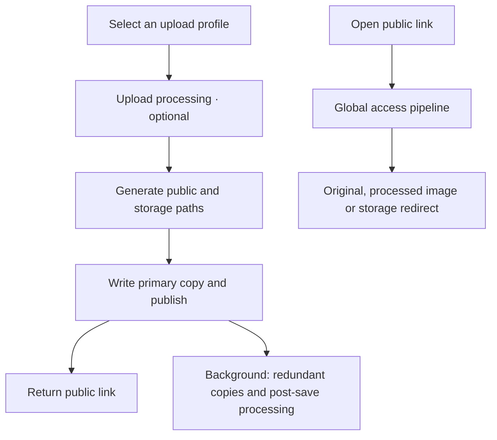

  

# Picloom

A self-hosted image hosting service with multiple storage backends and configurable image processing.

**English** · [简体中文](README.zh-CN.md)

[Documentation (中文)](https://llleixx.github.io/picloom/) · [Quick start (中文)](https://llleixx.github.io/picloom/guide/quick-start.html) · [MIT License](LICENSE)

## Features

- **Multiple storage backends and replicas.** Connect local directories, S3-compatible storage, WebDAV, OpenList and more. Use storage groups to select primary storage and keep redundant copies.
- **Separate public and storage paths.** Organize files in sharded directories while keeping public URLs flat. Replicas share one public path.
- **Processing at three stages.** Resize or watermark images before saving, generate variants on access, and run moderation or notifications after saving. Combine steps into reusable pipelines.
- **Import existing images in place.** Scan local, S3, OpenList or WebDAV storage without uploading again. Preserve existing links by matching the domain and public paths.
- **Reusable upload profiles.** Choose storage, path rules and processing once, then select a profile when uploading through the web interface or API. Upload tokens can be restricted to specific profiles.
- **Web management.** Manage images, replicas and background tasks; use chunked uploads and built-in SQLite backups. Add capabilities with path, storage and processing plugins.

## How it works

An **upload profile** combines path rules, a storage group and processing pipelines. A **storage source** connects to a directory or remote service; a **storage group** decides where primary and redundant copies are stored.

A successful upload means the primary copy is saved and the image is published. Redundant copies and post-save processing may still be pending. Post-save moderation can subsequently block or delete the image; it does not gate initial publication.

Access processing can generate thumbnails without replacing the stored image. See [concepts (中文)](https://llleixx.github.io/picloom/guide/concepts.html) for configuration examples.

## Built-in plugins

| Type | Plugins |
| --- | --- |
| Storage | [Local](src/builtins/storage/local/README.md), [S3](src/builtins/storage/s3/README.md), [WebDAV](src/builtins/storage/webdav/README.md), [OpenList](src/builtins/storage/openlist/README.md), [NodeImage](src/builtins/storage/nodeimage/README.md), [Telegram](src/builtins/storage/telegram/README.md) |
| Paths | [Random](src/builtins/path/random-path/README.md), [Date](src/builtins/path/date-path/README.md) |
| Processing | [Image Processing](src/builtins/processor/sharp/README.md), [Watermark](src/builtins/processor/watermark/README.md), [Tencent Cloud Moderation](src/builtins/processor/tencent-moderation/README.md), [Telegram Notification](src/builtins/processor/telegram-notification/README.md) |

Each plugin's README covers its configuration and limitations. Storage capabilities, including deletion and import, vary by backend.

## Getting started

Picloom is currently a `0.1.0` development version. Docker image publication is pending; to run it now, follow [local development (中文)](https://llleixx.github.io/picloom/development/contributing.html).

The [Docker quick start (中文)](https://llleixx.github.io/picloom/guide/quick-start.html) covers deployment configuration and the first upload. A fresh deployment creates a local storage source, storage group and upload profile named `Default`, ready for uploads after login.

- [Common recipes (中文)](https://llleixx.github.io/picloom/guide/recipes.html) — watermarks, thumbnails, replicas and moderation notifications.
- [Image management (中文)](https://llleixx.github.io/picloom/guide/files.html) — manage images and import existing libraries.
- [Data, backups and upgrades (中文)](https://llleixx.github.io/picloom/operations/data.html) — preserve data and check compatibility before upgrading.
- [HTTP API (中文)](https://llleixx.github.io/picloom/reference/http-api.html) — integrate uploads into other tools.

## Development

Built with Bun, TypeScript and Vue; supports SQLite and PostgreSQL.

- [Core development (中文)](https://llleixx.github.io/picloom/development/contributing.html)
- [Plugin development (中文)](https://llleixx.github.io/picloom/development/plugin-tooling.html)

Standalone plugin tooling lives in this repository: [`@picloom/plugin-sdk`](plugin-sdk/README.md)
and [`@picloom/create-plugin`](tools/create-plugin/README.md). Both npm packages are
prepared but not yet published. See [local tarball instructions (中文)](docs/development/plugin-tooling.md)
to create and build a plugin outside the main repository without publishing.

## License

[MIT](LICENSE)
