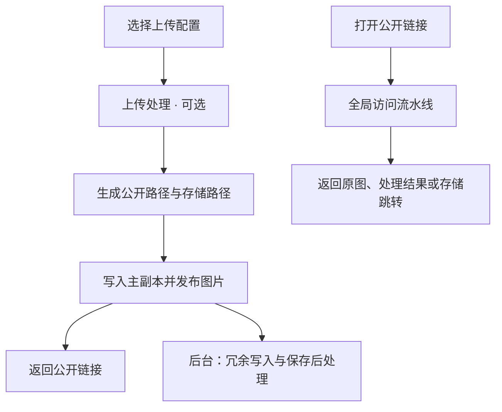

  

# Picloom

自托管图床，支持多种存储后端和可配置的图片处理流程。

[English](README.md) · **简体中文**

[文档](https://llleixx.github.io/picloom/) · [快速开始](https://llleixx.github.io/picloom/guide/quick-start.html) · [MIT 许可证](LICENSE)

## 项目特点

- **多存储与多副本。** 接入本地目录、S3 兼容存储、WebDAV、OpenList 等，通过存储组选择主存储并保留冗余副本。
- **公开路径与存储路径分离。** 文件可以按分片目录存放，公开链接保持简短；多个副本共用一个公开路径。
- **三个阶段的处理流水线。** 保存前缩放、加水印，访问时生成不同尺寸，保存后执行审核或通知。处理步骤可以按需组合、复用。
- **原地导入已有图片。** 扫描本地、S3、OpenList 或 WebDAV 存储，无需重新上传。配合原域名和公开路径，可保留已有链接。
- **复用上传规则。** 上传配置组合存储、路径和处理规则，网页与 API 上传时选择即可；上传令牌可限定允许使用的配置。
- **网页管理。** 管理图片、副本与后台任务，支持分片上传和 SQLite 内置备份，也可通过路径、存储和处理插件扩展能力。

## 如何工作

**上传配置**组合路径规则、存储组和处理流水线。**存储源**连接一个目录或远程服务，**存储组**决定主副本与冗余副本放在哪里。

上传成功表示主副本已保存、图片已发布；冗余写入与保存后处理可能仍在执行。保存后审核可能随后屏蔽或删除图片，不保证审核通过后才首次公开。

访问处理可以生成缩略图，不覆盖存储中的图片。配置示例见 [理解 Picloom](https://llleixx.github.io/picloom/guide/concepts.html)。

## 内置插件

| 类型 | 插件 |
| --- | --- |
| 存储 | [本地](src/builtins/storage/local/README.zh-CN.md)、[S3](src/builtins/storage/s3/README.zh-CN.md)、[WebDAV](src/builtins/storage/webdav/README.zh-CN.md) |
| 路径 | [随机路径](src/builtins/path/random-path/README.zh-CN.md)、[日期路径](src/builtins/path/date-path/README.zh-CN.md) |
| 处理 | [图片处理](src/builtins/processor/sharp/README.zh-CN.md)、[水印](src/builtins/processor/watermark/README.zh-CN.md)、[Telegram 通知](src/builtins/processor/telegram-notification/README.zh-CN.md) |

OpenList、NodeImage、Telegram 存储、腾讯云审核和 Horizon 由独立的 `picloom-extensions` 仓库维护，通过插件／主题管理安装 ZIP，不再随主程序内置。扩展仓库及首个 Release 正在准备发布。

各插件的 README 说明配置与限制；删除、导入等能力因存储后端而异。

## 开始使用

当前为 `0.1.0` 开发版本，Docker 镜像尚待发布。现在运行可按 [本地开发](https://llleixx.github.io/picloom/development/contributing.html) 从源码启动。

[Docker 快速开始](https://llleixx.github.io/picloom/guide/quick-start.html) 介绍部署配置与首次上传。全新部署会创建名为 `Default` 的本地存储源、存储组和上传配置，登录后即可上传。

- [常见场景](https://llleixx.github.io/picloom/guide/recipes.html)：水印、缩略图、多副本与审核通知。
- [图片管理](https://llleixx.github.io/picloom/guide/files.html)：管理图片、导入已有图库。
- [数据、备份与升级](https://llleixx.github.io/picloom/operations/data.html)：保留数据，升级前检查兼容性。
- [HTTP API](https://llleixx.github.io/picloom/reference/http-api.html)：接入其他上传工具。

## 参与开发

使用 Bun、TypeScript 和 Vue，支持 SQLite 与 PostgreSQL。

- [开发者指南](https://llleixx.github.io/picloom/development/)
- [核心开发](https://llleixx.github.io/picloom/development/contributing.html)
- [插件开发](https://llleixx.github.io/picloom/development/plugin-tooling.html)

在独立项目中开发插件与主题：

- 插件：[`@picloom/plugin-sdk`](https://github.com/llleixx/picloom-tooling/blob/main/plugin-sdk/README.md) 提供协议和运行时辅助函数，[`@picloom/plugin-tools`](https://github.com/llleixx/picloom-tooling/blob/main/tools/plugin-tools/README.md) 负责构建 ZIP，[`@picloom/create-plugin`](https://github.com/llleixx/picloom-tooling/blob/main/tools/create-plugin/README.md) 负责生成项目。
- 主题：[`@picloom/theme-sdk`](https://github.com/llleixx/picloom-tooling/blob/main/theme-sdk/README.md)、[`@picloom/theme-tools`](https://github.com/llleixx/picloom-tooling/blob/main/tools/theme-tools/README.md) 和 [`@picloom/create-theme`](https://github.com/llleixx/picloom-tooling/blob/main/tools/create-theme/README.md) 分别维护协议、开发工具和项目生成。

开发工具通过 npm 安装精确版本：插件 SDK 0.1.0、主题 SDK 0.1.1、公共规则和两个工具包 0.1.0、两个脚手架 0.1.1。

## 许可证

[MIT](LICENSE)

### 三仓本地开发

主仓库保留应用、内置实现、默认主题与协议集成示例；SDK、工具和脚手架由相邻的 `picloom-tooling` 独立维护，官方可选扩展位于 `picloom-extensions`。

主仓库与官方扩展直接引用 npm 精确版本，分别执行 `bun install --frozen-lockfile` 即可，无需工具链仓库或本地压缩包。工具链源码开发的可选联调方式见[工具链本地联调](https://github.com/llleixx/picloom-tooling/blob/main/README.zh-CN.md)。
