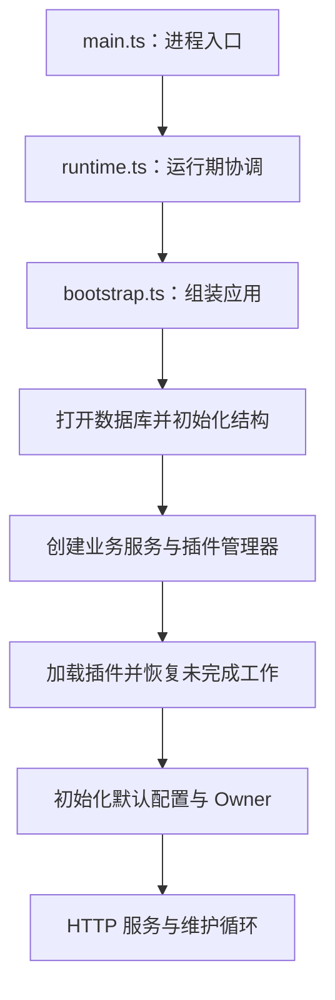
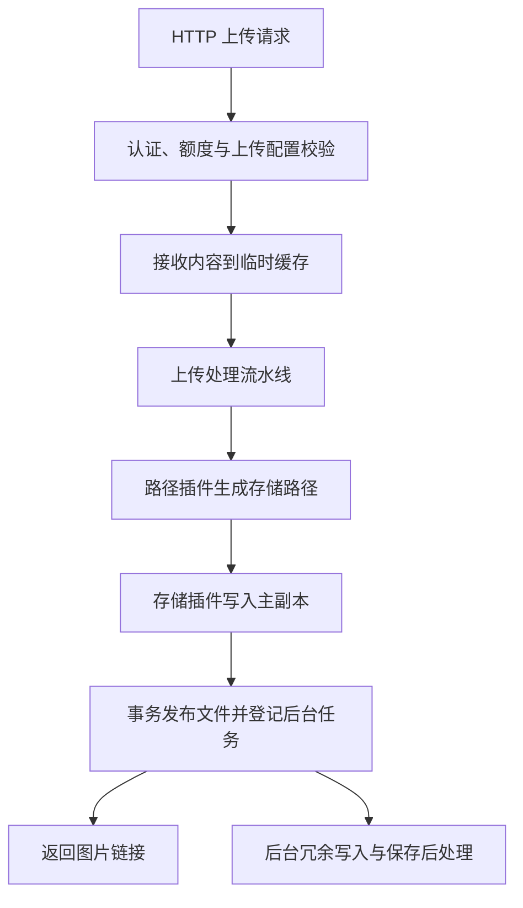
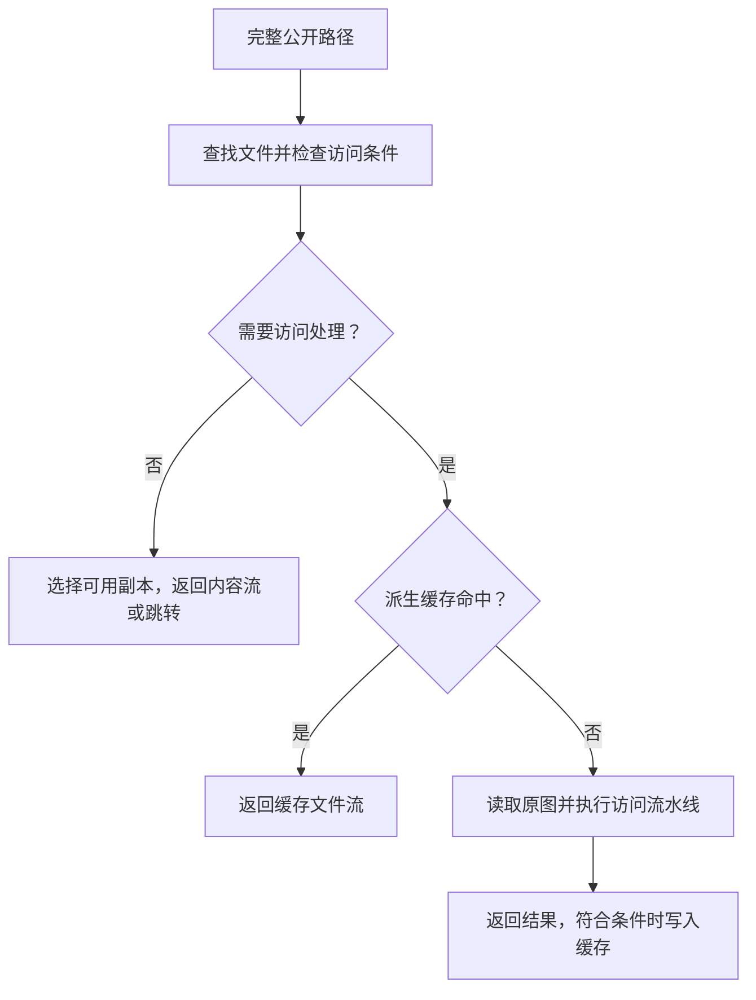

# 架构与代码导航

Picloom 的核心负责决定文件如何上传、访问和清理，插件负责执行路径生成、存储和图片处理。数据库记录文件、副本与任务的状态，图片内容由存储插件保存；前端通过 HTTP API 操作这些能力。

## 应用如何启动

| 入口 | 职责 |
| --- | --- |
| `src/main.ts` | 启动 Bun HTTP 服务，解析可信代理地址，接收停机信号 |
| `src/runtime.ts` | 调用应用组装、首次初始化，协调请求、维护循环、备份与停机 |
| `src/bootstrap.ts` | 打开持久化层、连接业务服务、加载插件、恢复文件和上传会话，提供应用关闭方法 |
| `src/cli.ts` | 执行初始化、密码恢复等命令；不启动 HTTP 服务 |

数据目录锁防止多个应用实例同时使用同一目录。CLI 也需要这个锁，运行初始化前应停止使用该目录的服务。

## 一次上传经过哪里

分片会话由 `core/uploads.ts` 管理，合并后的内容进入文件上传流程。`core/files.ts` 负责上传编排、流水线和文件操作；返回成功时不要求后台冗余与保存后处理全部完成。

## 一次图片访问经过哪里

`core/derived-images.ts` 协调派生处理与共享工作，`core/cache.ts` 管理派生缓存，`core/image-response.ts` 组织图片响应。同一派生结果可以被多个请求共同等待；其中一个请求取消，不应终止其他请求仍需要的处理。

## 模块职责

| 位置 | 负责什么 | 修改时注意 |
| --- | --- | --- |
| `src/http` | 路由、认证、输入解析、响应转换 | 业务状态变化交给核心服务 |
| `src/core` | 上传、访问、配置、账号、导入和任务等业务规则 | 当前 `files.ts` 仍承担多项文件编排，先沿调用链定位 |
| `src/persistence` | 数据访问接口、查询与初始化 | 核心通过接口访问数据；两种数据库共用查询实现 |
| `src/plugins` | 安装包、配置验证、实例创建与释放 | 插件调用期间持有实例租约 |
| `src/builtins` | 内置插件实现 | 遵循与外部插件相同的公共协议 |
| `plugin-sdk` | 插件类型、宿主服务协议和辅助函数 | 协议变更需同步示例与开发文档 |
| `src/infra` | 文件、临时空间、图片、密钥和备份等基础能力 | 外部资源不随数据库事务回滚 |
| `shared` | 前后端共用的类型、校验和设置定义 | 不放入只属于服务端的依赖 |
| `web` | Vue 上传与管理界面 | 通过 API 读取和修改状态 |

## 从哪里开始修改

| 需求 | 优先查看 |
| --- | --- |
| 上传限制、分片与取消 | `core/uploads.ts`、`core/files.ts` |
| 图片访问、变换或缓存 | `core/files.ts`、`core/derived-images.ts`、`core/cache.ts` |
| 后台领取、重试与删除 | `core/tasks.ts`、`core/files.ts`、`persistence/repositories.ts` |
| 上传配置与流水线配置 | `core/configuration.ts`、`core/request-params.ts` |
| 设置及默认值 | `shared/runtime-settings.ts`、`src/config.ts`、`core/delivery-settings.ts` |
| 备份与停机 | `src/runtime.ts`、`infra/backup.ts` |

表中省略的服务端路径均以 `src/` 为根。涉及数据库修改继续阅读 [数据访问与初始化](./persistence.md)；涉及异步工作继续阅读 [状态、任务与资源生命周期](./states.md)。
