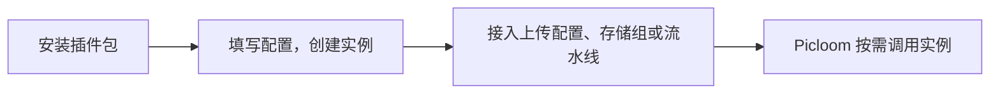

# 插件基础

假设你想把上传图片缩小、按日期命名、保存到自己的存储，再进行审核。Picloom 已有上传、文件记录和后台任务等能力；插件只实现其中一个环节，不需要另写一套图床服务。

## 跟着一张图片走

下面是职责示意，省略了副本、缓存和失败分支：


上传处理可以改变最终保存的图片。保存后处理由后台执行，例如决定是否屏蔽已保存的图片，不再替换图片内容。

访问图片是另一次过程：存储插件提供内容，访问处理按需生成缩略图等结果，再返回给访问者。原图不变；缓存命中时可能直接返回结果，存储也可能提供重定向链接。

## 三类插件，三个处理阶段

| 类型 | 负责什么 | 在哪里使用 |
| --- | --- | --- |
| 路径插件 `path` | 返回公开路径中的相对部分和存储键 | 上传配置 |
| 存储插件 `storage` | 实际写入、读取、删除文件 | 存储源 |
| 处理插件 `processor` | 转换图片，或给出保存后的处理意见 | 流水线步骤 |

处理插件包含上传 `upload`、访问 `access`、保存后 `post_save` 三个阶段。一个插件可以支持多个阶段，但每个阶段分别定义配置和实现。先选择需要介入的时机，再选择对应教程。

## 一个插件由哪些文件组成

最小源码目录和构建后的安装包如下：

```text
examples/path/                 path.zip（ZIP 根目录）
├── plugin.json   ──────────→  ├── plugin.json
└── index.ts      ── 构建 ──→  └── index.js
```

| 文件 | 职责 |
| --- | --- |
| `plugin.json` | 清单，告诉 Picloom 包的身份、版本、类型和入口位置 |
| `index.ts` | 插件源码，默认导出一个插件定义，描述配置及实现方法 |
| `index.js` | 构建后的 JavaScript 入口，Picloom 实际加载它 |

源码可以拆成多个文件，也可以引用依赖。示例构建会把需要的代码合并进入口；若保留其他运行文件，它们也必须包含在包中。Picloom 不会自动安装包内的 npm 依赖。

示例通过 `../../plugin-sdk` 引用仓库 SDK，提供类型和辅助函数，例如：

```ts
import { PluginError, type Definition } from "../../plugin-sdk";
```

这是相对于 `examples/path/index.ts` 的路径，移动源码时需要调整。图片库使用宿主提供的 `services.images.sharp`，不单独打包 Sharp。

## 清单 plugin.json

<<< ../../examples/path/plugin.json

| 字段 | 类型 | 必填 | 含义与约束 |
| --- | --- | --- | --- |
| `id` | `string` | 是 | 稳定标识；小写字母开头，仅含小写字母、数字、点、下划线、短横线，最长 100 字符；外部插件不能以 `builtin.` 开头 |
| `version` | `string` | 是 | 代码版本；数字开头，仅含字母、数字、`.`、`+`、`-`，最长 64 字符，例如 `1.0.0` |
| `kind` | `"path" \| "storage" \| "processor"` | 是 | 插件类型 |
| `apiVersion` | `1` | 是 | 当前支持的宿主接口版本 |
| `entry` | `string` | 是 | 包内 JavaScript 相对路径，例如 `index.js`；不能越出包目录 |

入口默认导出的 `id/version/kind/apiVersion` 必须与清单一致。清单只用于定位和检查包，安装确认显示 ID 和版本；名称在入口的 `content` 中定义，加载成功后按界面语言显示。

## 代码默认导出什么

入口默认导出 `Definition` 对象，不是运行实例。所有类型都有以下身份字段：

| 字段 | 类型 | 必填 | 用途 |
| --- | --- | --- | --- |
| `id`、`version`、`kind`、`apiVersion` | 同清单 | 是 | 与安装包对应 |
| `defaultLocale` | `string` | 是 | 内容默认语言，使用规范语言代码，例如 `en-US` |
| `content` | `Record<string, PluginContent>` | 是 | 按语言保存名称、说明等文案；默认语言必须提供非空 `name`，见 [配置与宿主服务](./plugin-config.md#界面提示与翻译) |

身份之后，按类型组织实现：

```text
路径 / 存储定义                 处理插件定义
├── 身份字段                   ├── 身份字段
├── configSchemaVersion        └── stages（至少一个阶段）
├── configSchema                   └── upload / access / post_save
└── createInstance                     ├── configSchemaVersion
    └── 返回运行方法                   ├── configSchema
                                       └── createInstance
                                           └── 返回该阶段的运行方法
```

`configSchema` 描述管理员要填写的配置，`createInstance` 根据这份配置创建可调用的对象。可选的校验、迁移和界面字段见 [配置描述字段](./plugin-config.md#配置描述字段)。各类教程会列出运行对象必须实现的方法。

## 从代码到一次调用



| 名称 | 可以怎样理解 |
| --- | --- |
| 插件包 | 安装用的 ZIP，包含清单和可执行代码 |
| 插件定义 | 代码声明的身份、配置项和能力 |
| 插件实例 | 某个版本配上一份具体配置，生成的运行对象 |

例如，同一个存储插件可以创建两个实例，分别连接不同存储桶。安装代码不会自动创建存储源或添加流水线步骤。

代码通过 `createInstance` 接收配置和宿主服务，返回运行方法。Picloom 复用这个对象处理后续调用；它可能同时处理多个文件，不是每次请求都重新创建。

插件运行在服务主进程，没有沙箱。安装需要 Owner 权限，只安装可信代码。

## 准备并构建示例

需要 Bun、`zip` 命令，以及一个可用的 Picloom 部署。在终端执行：

```sh
git clone https://github.com/llleixx/picloom.git
cd picloom
bun install --frozen-lockfile
bun run build:examples
```

每个示例目录都有 `plugin.json`（清单）和 `index.ts`（实现）。脚本将 TypeScript 和 SDK 引用打包成 JavaScript，生成可安装的 ZIP：

| 教程 | 源码目录 | `outputs/examples/` 下的产物 |
| --- | --- | --- |
| [路径插件](./plugin-path.md) | `examples/path` | `path.zip` |
| [存储插件](./plugin-storage.md) | `examples/storage` | `storage.zip` |
| [上传处理](./processors/upload.md) | `examples/processor` | `processor.zip` |
| [访问处理](./processors/access.md) | `examples/access` | `access.zip` |
| [保存后处理](./processors/post-save.md) | `examples/post-save` | `post-save.zip` |

选择一个教程即可，不需要一次安装所有示例。各教程先解释职责和一次调用，再列出必需、可选接口及输入输出，最后给出完整实现和验证步骤。第一次开发建议从路径插件开始。

修改已安装的示例后，需要同步增加清单和入口中的版本，再安装并应用升级；同 ID、同版本不能覆盖。详见 [打包、发布与升级](./plugin-release.md)。
