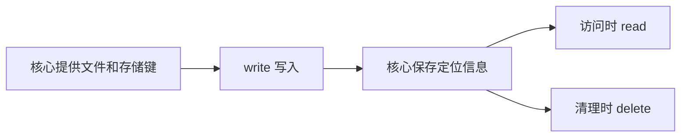

# 存储插件

## 想实现什么

把图片保存到自己的本地目录，并让 Picloom 能再次读取和删除它。核心已经决定文件名称，存储插件负责实际操作文件。

## 在哪里执行



## 谁负责什么

Picloom 管理账户、公开路径、副本和任务；插件只对接存储。插件不需要创建文件记录，也不直接决定公开 URL。

同一接口既能连接本地目录，也能连接远端服务。一次写入返回后，核心需要保留足够的信息，供下一次读取或删除使用。

## 看一次调用

假设核心传入 `storageKey: "2026/10/18/abc.jpg"` 和图片流，本地根目录配置为 `./example-images`：

1. `write` 将内容保存到根目录下的 `2026/10/18/abc.jpg`，返回 `{ locator: null }`。
2. 访问时，`read` 收到相同键，返回文件流。
3. 删除时，`delete` 收到相同键，删除文件。

| 名称 | 含义 |
| --- | --- |
| `storageKey` | 路径插件给出的相对存储键 |
| `file` | 文件输入，通过 `openRead()` 获取流，不保证有本地路径 |
| `locator` | 插件返回的额外定位信息；核心保存并原样传给后续调用 |
| `operationId` | 写入或删除操作的标识，可用于识别重复调用 |

本地示例不需要额外定位信息。若远端服务返回对象 ID，可用 `{ locator: { objectId: "remote-123" } }` 保存；也允许字符串定位信息，不要放入凭证。

## 定义与能力清单

默认导出 `Definition<"storage">`，设置 `kind: "storage"`，在顶层声明配置描述。

| 位置 | 成员 | 必需 | 作用 |
| --- | --- | --- | --- |
| 定义 | `defaultLocale`、`content` | 是 | 默认语言与展示文案，默认语言必须有非空名称；见 [多语言文案](./plugin-config.md#界面提示与翻译) |
| 定义 | `configSchemaVersion`、`configSchema`、`createInstance` | 是 | 创建 `StoragePlugin` 运行对象，见 [共用协议](./plugin-config.md#配置描述字段) |
| 定义 | `validateConfig`、`migrateConfig`、`uiHints` | 否 | 校验、升级和表单展示 |
| 定义 | `localDirectory` | 否 | 声明本地存储目录 |
| 运行对象 | `write`、`read`、`delete` | 是 | 基本读写和删除 |
| 运行对象 | `recoverWrite` | 否 | 核对不确定的写入结果 |
| 运行对象 | `listFiles` | 否 | 支持扫描导入 |
| 运行对象 | `dispose` | 否 | [释放连接等资源](./plugin-errors.md#dispose-释放实例) |

以下方法的第二个参数都为必需的 [Context](./plugin-config.md#调用上下文)，提供 `signal/requestId/log`。`Locator` 表示 `string | Config | null`，其中 `Config` 是 JSON 对象。

## write：写入图片

核心需要保存一个主副本或冗余副本时调用。完成后才可返回，不能遗留未等待的写入。

```ts
write(input: {
  operationId: string;
  fileId: string;
  storageKey: string;
  file: FileInput;
}, context: Context): Promise<{ locator?: Locator }>;
```

| 输入字段 | 类型 | 可选 | 含义 |
| --- | --- | --- | --- |
| `operationId` | `string` | 否 | 本次操作标识，供远端幂等处理使用 |
| `fileId` | `string` | 否 | Picloom 文件 ID |
| `storageKey` | `string` | 否 | 对象的相对存储键 |
| `file` | `FileInput` | 否 | [元数据与可读取的文件流](./plugin-config.md#文件与输出) |

返回对象中的 `locator?: Locator` 是可选定位信息，省略时核心按 `null` 保存。只能在确认写入成功后返回；失败时抛错，是否可能生效通过 [PluginError](./plugin-errors.md#pluginerror-的四个字段) 表达。

## read：读取图片

公开访问或图片处理需要内容时调用。

```ts
read(input: {
  storageKey: string;
  locator: Locator;
  mode: "auto" | "stream";
}, context: Context): Promise<ReadResult>;
```

| 输入字段 | 类型 | 可选 | 含义 |
| --- | --- | --- | --- |
| `storageKey` | `string` | 否 | 保存时使用的相对键 |
| `locator` | `Locator` | 否 | 已保存的定位信息，可能为 `null` |
| `mode` | `"auto" \| "stream"` | 否 | `auto` 接受流或跳转；`stream` 必须提供流 |

`ReadResult` 为以下二选一，不能混合返回：

| 返回形式 | 字段 | 类型 | 必需 | 核心行为 |
| --- | --- | --- | --- | --- |
| 流 | `type` | `"stream"` | 是 | 读取或转发内容 |
| 流 | `stream` | `ReadableStream<Uint8Array>` | 是 | 图片内容流 |
| 流 | `mimeType` | `string` | 否 | 内容的 MIME 类型 |
| 流 | `byteSize` | `number` | 否 | 内容大小，字节 |
| 跳转 | `type` | `"redirect"` | 是 | 返回重定向 |
| 跳转 | `url` | `string` | 是 | 可访问的 HTTP(S) URL |
| 跳转 | `expiresAt` | `number` | 否 | URL 过期的 Unix 毫秒时间戳，用于限制响应缓存时间 |

图片处理需要实际内容，不能在 `mode: "stream"` 时仍返回签名链接。返回流后，消费可能尚未结束；应在流结束、出错或取消时释放它持有的连接，而不是在返回时提前关闭。

## delete：删除对象

核心清理副本时调用。

```ts
delete(input: {
  operationId: string;
  storageKey: string;
  locator: Locator;
}, context: Context): Promise<void>;
```

| 输入字段 | 类型 | 可选 | 含义 |
| --- | --- | --- | --- |
| `operationId` | `string` | 否 | 删除操作标识 |
| `storageKey` | `string` | 否 | 目标的相对键 |
| `locator` | `Locator` | 否 | 已保存的定位信息，可能为 `null` |

成功无数据返回，失败抛错。目标已不存在通常可视为成功，但认证失败或查询超时不能当作“不存在”。只删除指定对象，不删除整个存储根目录。

## recoverWrite：核对写入结果（可选）

写入结果不确定时，核心可以调用它核实。查询失败不能推断为没有写入。

```ts
recoverWrite(input: {
  operationId: string;
  fileId: string;
  storageKey: string;
  expectedSize: number;
  locator: Locator;
}, context: Context): Promise<
  | { status: "stored"; locator?: Locator }
  | { status: "notStored" | "unknown" }
>;
```

| 输入字段 | 类型 | 可选 | 含义 |
| --- | --- | --- | --- |
| `operationId` | `string` | 否 | 原写入操作标识 |
| `fileId` | `string` | 否 | Picloom 文件 ID |
| `storageKey` | `string` | 否 | 待核对的相对键 |
| `expectedSize` | `number` | 否 | 预期内容大小，字节 |
| `locator` | `Locator` | 否 | 已有定位信息，可能为 `null` |

| 返回 `status` | 含义 | 附加字段 |
| --- | --- | --- |
| `stored` | 确认已写入 | 可选 `locator: Locator`，供核心保存 |
| `notStored` | 确认没有写入 | 无 |
| `unknown` | 无法判断 | 无 |

没有可靠查询能力可以不实现；实现后也不能为了推进任务而猜测结果。

## listFiles：扫描导入（可选）

管理员导入存储源中的已有图片时，核心逐页调用此方法。

```ts
listFiles(input: {
  scope?: string;
  cursor?: string;
  limit: number;
}, context: Context): Promise<{
  items: Array<{
    storageKey: string;
    locator?: Locator;
    byteSize?: number;
    mimeType?: string;
  }>;
  nextCursor: string | null;
}>;
```

| 输入字段 | 类型 | 可选 | 含义 |
| --- | --- | --- | --- |
| `scope` | `string` | 是 | 当前存储源内的扫描范围；不传时扫描整个源 |
| `cursor` | `string` | 是 | 上一页返回的游标；第一页不传 |
| `limit` | `number` | 否 | 本页条数限制 |

| 返回字段 | 类型 | 必需 | 含义 |
| --- | --- | --- | --- |
| `items` | 数组 | 是 | 本页文件；没有文件时为空数组 |
| `items[].storageKey` | `string` | 是 | 相对于存储源的文件键，不是公开 URL |
| `items[].locator` | `Locator` | 否 | 后续读取、删除所需的定位信息 |
| `items[].byteSize` | `number` | 否 | 字节大小 |
| `items[].mimeType` | `string` | 否 | MIME 类型 |
| `nextCursor` | `string \| null` | 是 | 下一页游标；结束必须返回 `null` |

游标由插件定义，核心原样传回。`scope` 只缩小扫描范围，不改变存储根目录，也不应从返回的键中剥离该范围前缀。导入选项 `stripDirectories` 由核心用于生成逻辑路径，默认 `0`；不传给插件，不修改 `storageKey` 或 `locator`。

## 最小实现

先按[快速开始](./plugin-tooling.md)创建独立项目。下面展示仓库中的完整示例；
复制到 `src/index.ts` 时，按[使用教程示例](./plugin-tooling.md#使用教程示例)调整 SDK 导入、清单身份和插件类型。


本例先根据配置创建根目录，再返回三个方法：写入临时文件并发布、读取文件流、删除目标。

<<< ../../examples/storage/index.ts

`safePath` 检查目标路径；临时文件和硬链接用于发布完整文件且不覆盖已有目标。`write` 返回前必须等待写入完成。

## 接入并验证

在独立项目中运行 `bun run build`，使用生成的 `dist/<插件ID>-<版本>.zip`。
下面的 **Example …** 是示例名，实际应选择入口 `content` 中设置、按当前界面语言显示的名称：

1. 安装 生成的 ZIP，创建 **Example local storage** 存储源，根目录填 `./example-images`。
2. 创建存储组并加入该存储源，创建上传配置并关联此组。
3. 上传图片，打开公开链接，再删除图片，确认对应文件被清理。

相对目录以应用数据目录为基准。默认 Docker 布局中，本例位于宿主机 `./data/app/example-images`。

## 本地目录声明（可选）

在定义顶层声明 `localDirectory: { configPath: "/root" }`。`configPath` 是必需的字符串 JSON Pointer，指向 Schema 中不可变、非敏感的字符串字段；不是目录本身。

用户填写 `./example-images` 时，宿主以应用数据目录为基准解析并保存绝对路径，插件收到的配置已完成解析。声明同时供容量统计和备份识别；不要让核心依靠插件 ID 猜测目录。

## 扩展与约束

重复写入不能覆盖其他文件；远端支持幂等键时可使用 `operationId`。本例没有实现写入结果恢复，接入远端服务时还需遵守 [错误与重试规则](./plugin-errors.md)。
