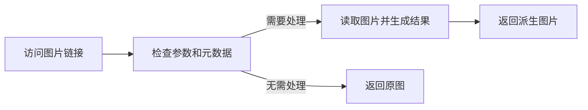

# 访问处理

## 想实现什么

保存一张宽 2400 像素的原图，通过链接上的 `?width=320` 取得缩略图。去掉参数后仍可访问原图，不需要上传多个尺寸。

## 在哪里执行



这是未命中派生缓存时的处理过程。命中缓存时，Picloom 可以直接返回已有结果。

## 谁负责什么

插件按本次参数生成返回内容，不覆盖存储中的原图。Picloom 负责查找文件、按需读取源内容、管理派生缓存和返回响应。

访问插件使用 `getFile()` 延迟取得图片；仅检查参数或元数据时，不需要先下载完整文件。

## 看一次调用

访问 `.../abc.png?width=320`，且管理员已在该步骤启用 `width`：

1. `check` 收到 `params.width: 320` 和元数据，返回 `applicable`。
2. `process` 调用 `getFile()`，读取原图并缩小，返回 `replace` 和输出。
3. Picloom 返回宽 320 像素的图片，可缓存派生结果，原图保持不变。

没有传 `width` 时，本例的 `check` 返回 `noop`，无需取图处理。

## 定义与能力清单

定义设置 `kind: "processor"`，将以下阶段描述放在 `stages.access` 中，而不是插件顶层。

| 位置 | 成员 | 必需 | 作用 |
| --- | --- | --- | --- |
| 阶段描述 | `configSchemaVersion`、`configSchema`、`createInstance` | 是 | 创建 `AccessPlugin`，见 [共用协议](../plugin-config.md#配置描述字段) |
| 阶段描述 | `paramsSchema` | 否 | 声明可接受的本次请求参数；还需管理员逐项启用 |
| 阶段描述 | `validateConfig`、`migrateConfig`、`uiHints` | 否 | 配置校验、升级和展示 |
| 运行对象 | `check`、`process` | 是 | 检查适用性，执行处理 |
| 运行对象 | `cacheable` | 否 | 布尔值，默认允许派生缓存；`false` 禁用共享派生缓存 |
| 运行对象 | `dispose` | 否 | [释放实例资源](../plugin-errors.md#dispose-释放实例) |

`Parameters` 是 `Record<string, string | number | boolean>`，没有本次参数时为空对象。文件及元数据的完整字段见 [文件与输出](../plugin-config.md#文件与输出)。

## check：决定是否执行

核心对当前图片调用检查；只有返回 `applicable` 才调用本步骤的 `process`。

```ts
check(input: {
  params: Parameters;
  readonly metadata: Readonly<Metadata>;
  getFile(): Promise<FileInput>;
  limits: { maxDimension: number; maxPixels: number };
}, context: CheckContext): Promise<{
  status: "applicable" | "noop" | "unsupported";
  reason?: string;
}>;
```

| 参数 / 字段 | 类型 | 可选 | 含义 |
| --- | --- | --- | --- |
| `input.params` | `Parameters` | 否 | 已筛选并校验的请求参数，不自动合并固定配置 |
| `input.metadata` | `Readonly<Metadata>` | 否 | 当前图片元数据，可先判断是否需要取图 |
| `input.getFile()` | `() => Promise<FileInput>` | 否 | 无参数，按需取得当前图片输入；必须等待完成 |
| `input.limits.maxDimension` | `number` | 否 | 最大单边尺寸，像素 |
| `input.limits.maxPixels` | `number` | 否 | 最大像素总数 |
| `context` | `CheckContext` | 否 | 取消、日志及只读 `data.get`，见 [调用上下文](../plugin-config.md#调用上下文) |

返回对象必须含 `status`，可选 `reason: string` 说明原因：

| `status` | 核心行为 |
| --- | --- |
| `applicable` | 调用本步骤的 `process` |
| `noop` | 不处理，直接进入下一步 |
| `unsupported` | 根据步骤配置跳过或中止；中止时使用 `reason` 说明原因 |

检查阶段不能创建输出，也不能写入 `context.data`。执行异常应抛错，不要用 `unsupported` 隐藏失败。

## process：执行处理

检查通过后调用，固定配置通过实例闭包使用，本次参数来自 `input.params`。

```ts
process(input: {
  params: Parameters;
  readonly metadata: Readonly<Metadata>;
  getFile(): Promise<FileInput>;
  limits: { maxDimension: number; maxPixels: number };
  createOutput(): Promise<Output>;
}, context: PipelineContext): Promise<
  | { status: "pass" }
  | { status: "replace"; output: Output }
  | { status: "reject"; reason: string }
>;
```

| 参数 / 字段 | 类型 | 可选 | 含义 |
| --- | --- | --- | --- |
| `input.params` | `Parameters` | 否 | 本次请求参数 |
| `input.metadata` | `Readonly<Metadata>` | 否 | 当前图片元数据，可先判断是否需要取图 |
| `input.getFile()` | `() => Promise<FileInput>` | 否 | 无参数，按需取得当前图片输入；必须等待完成 |
| `input.limits.maxDimension` | `number` | 否 | 最大单边尺寸，像素 |
| `input.limits.maxPixels` | `number` | 否 | 最大像素总数 |
| `input.createOutput()` | `() => Promise<Output>` | 否 | 无参数，创建本次处理的输出对象 |
| `context` | `PipelineContext` | 否 | 取消、日志及可读写的 `data`，见 [调用上下文](../plugin-config.md#调用上下文) |

| 返回形式 | 必需字段 | 核心行为 |
| --- | --- | --- |
| 保留 | `status: "pass"` | 当前图片不变，继续下一步 |
| 替换 | `status: "replace"`、`output: Output` | 校验输出并更新当前图片，继续下一步 |
| 拒绝 | `status: "reject"`、`reason: string` | 中止本次访问并报错 |

输出来自本次 `createOutput()`，写入完成后才能返回。输出接口见 [文件与输出](../plugin-config.md#文件与输出)。

## 最小实现

本例没有固定配置，只有可选的 `width` 请求参数。先判断是否需要处理，再读取图片：

<<< ../../../examples/access/index.ts

`output.write` 写入宿主管理的临时输出，完成后返回 `replace`。本例使用宿主的 Sharp，并在取消时销毁处理资源。

## 接入并验证

按 [构建步骤](../plugin-start.md#准备并构建示例) 生成示例包后：

1. 安装 `access.zip`，在全局访问流水线中添加 **Example thumbnail**，启用参数 `width`。
2. 测试时先只保留这个访问步骤，上传一张宽于 320 像素的静态 JPEG、PNG 或 WebP。
3. 打开带 `?width=320` 的链接，确认宽度为 320；去掉参数，确认仍是原尺寸。

## 扩展与约束

`getFile()` 必须等待完成，返回的文件仍通过 `openRead()` 读取，不保证有本地路径。输出只能写一次，并且只能返回本次调用创建的输出。

访问实例默认允许共享派生缓存，需要禁用时在运行对象中返回 `cacheable: false`。缓存命中可能跳过整个处理过程，不要依赖插件逐次记录访问或发送通知；浏览器/CDN 缓存还可能使请求根本不抵达 Picloom。

本例将输入读入内存，不放大小图。处理大图时需考虑解码内存，并传递取消信号，见 [错误、取消与并发](../plugin-errors.md)。
