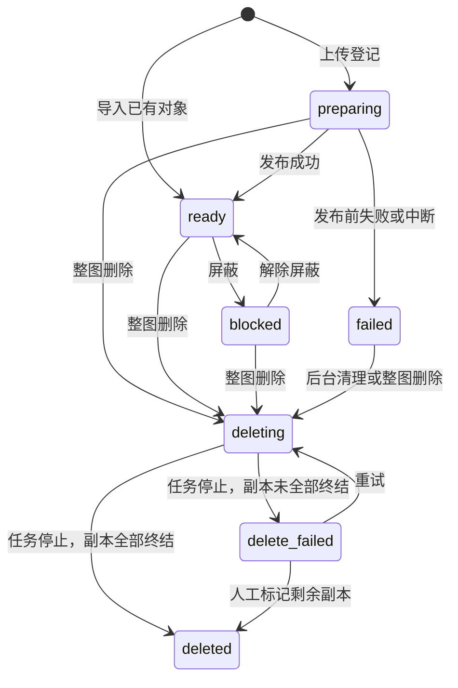
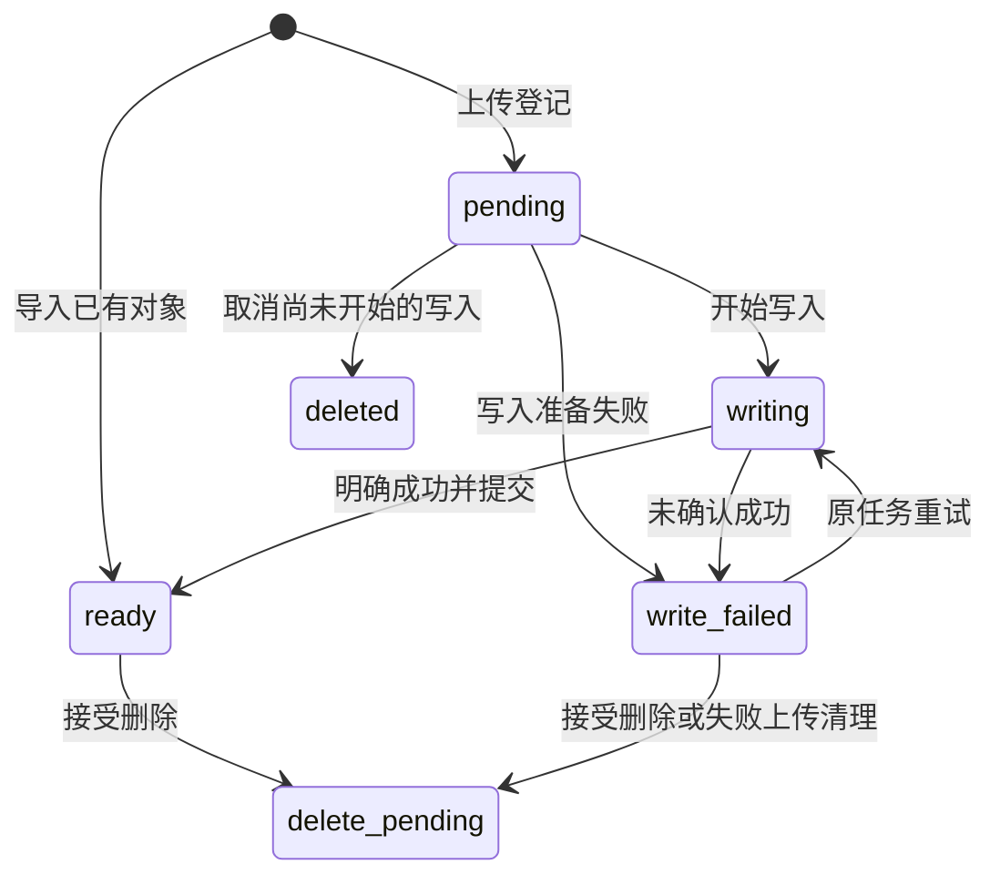
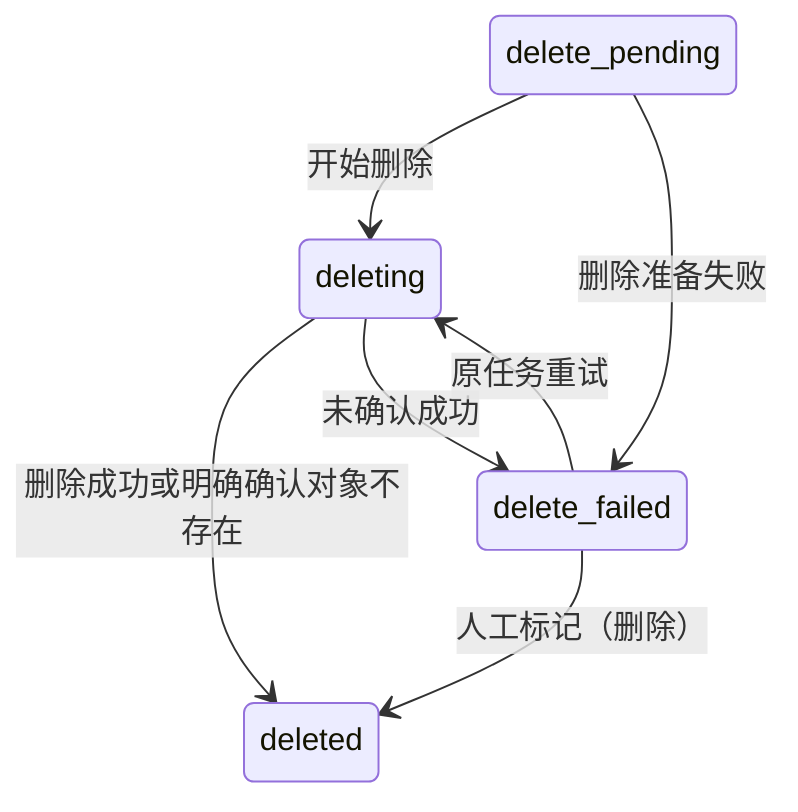
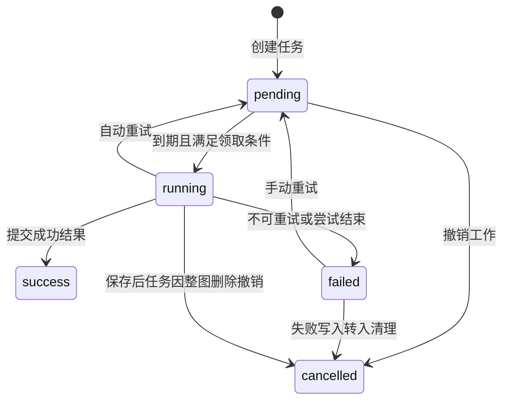

# 文件、副本与任务状态机

修改上传、后台任务或删除流程时，需要同时检查文件、副本与任务的状态。本页说明三者的转移条件和最终结果；界面操作见[图片管理](../guide/files.md)，请求格式见 [HTTP API](../reference/http-api.md#其他管理入口)。

## 模型概览

| 对象 | 职责 | 状态数量 |
| --- | --- | --- |
| 文件 | 记录上传是否发布、是否允许公开访问、是否进入整图删除 | 7 |
| 副本 | 记录一个存储实例上的写入、删除与管理生命周期 | 8 |
| 任务 | 记录一项工作是否等待、执行、成功、失败或取消 | 5 |

一个文件可以有多个副本，同一文件在同一存储实例最多有一条副本记录。写入和删除任务关联一个副本，保存后任务关联文件与处理链。

文件 `ready` 表示允许公开访问，读取仍需选取 `ready` 副本；它不保证每个副本或任务都已成功。副本 `deleted` 表示结束管理，文件 `deleted` 表示整图删除流程结束，记录均保留。这些状态不保证远端对象不存在。

## 文件状态机

| 状态 | 含义 | 访问与后续工作 |
| --- | --- | --- |
| `preparing` | 上传已登记，尚未发布 | 不公开；等待首份成功并通过发布校验 |
| `ready` | 已发布 | 允许公开访问；其余写入和保存后任务可继续 |
| `blocked` | 已发布，但被保存后处理屏蔽 | 不公开；保留管理员私密预览，其余写入可继续 |
| `failed` | 本次上传未能发布 | 不公开；等待后台转入整图删除 |
| `deleting` | 已接受整图删除 | 不公开；停止写入和保存后工作，清理全部副本 |
| `delete_failed` | 整图删除的任务已停止，仍有未终结副本 | 等待删除重试或人工标记为已删除 |
| `deleted` | 全部副本已终结，相关任务已停止 | 不再执行文件任务 |

### 首次发布与上传失败

核心上传处理开始时检查权限与额度并选择上传计划；分片在完成请求合并后进入此流程。此后不因权限、额度或配置版本变化重新裁决上传资格。首次发布在事务中确认文件仍为 `preparing`、至少一个副本为 `ready`，原子累计一次成功次数；有保存后步骤则创建一个 `action` 任务。实际依赖消失或存储失败仍按原有错误流程处理。

发布前所有目标的首轮写入均结束且没有成功副本时，上传直接失败，不等待自动重试。已有副本促成发布后，其他目标写入失败只影响对应副本，可以按任务规则继续重试。上传登记之前的失败可能没有文件、副本或任务记录。

导入直接建立 `ready` 文件和副本，不创建写入任务、不自动补齐副本，也不执行保存后处理。

### 屏蔽与删除

保存后任务可以屏蔽或删除文件。后续步骤失败仍保留已接受的处置，因此文件可以为 `blocked`，同时保存后任务为 `failed`。解除屏蔽只恢复文件为 `ready`；处置的累计规则见[保存后处理](./processors/post-save.md#如何形成累计处置)。

整图删除包括上传失败后的后台清理、用户删除、保存后删除和替换旧图：先持久化删除意图，停止公开访问，再清理副本。后台扫描到 `failed` 文件时，将其转为 `deleting` 并清除原上传错误，复用整图删除流程。仅对 `deleting/delete_failed` 文件判断整图是否终结：

| 当前条件 | 文件结果 |
| --- | --- |
| 仍有 `pending/running` 任务 | 等待任务停止 |
| 任务均停止，仍有非 `deleted` 副本 | `delete_failed` |
| 任务均停止，副本全部为 `deleted` | `deleted`，设置 `deleted_at` |

停止的任务可以是 `success/failed/cancelled`。

## 副本状态机

| 状态 | 含义 |
| --- | --- |
| `pending` | 已登记目标，尚未开始写入 |
| `writing` | 已开始写入，成功结果尚未提交 |
| `ready` | 写入明确成功，或已有对象导入成功 |
| `write_failed` | 未确认写入成功，包括准备失败、明确失败和结果不确定 |
| `delete_pending` | 已登记删除意图，尚未开始删除 |
| `deleting` | 已开始删除，成功结果尚未提交 |
| `delete_failed` | 未确认删除成功，包括准备失败、明确失败和结果不确定 |
| `deleted` | 管理生命周期已终结，不再读取、写入、删除或重试 |

### 写入与清理入口

同一副本不同时执行写入和删除。转入删除时，先等待在途写入退出并保存结果，再取消仍为 `pending/failed` 的写入任务，保留成功任务。只有尚未开始写入的 `pending` 副本可以在取消后直接终结；`write_failed` 必须进入删除流程，此规则适用于失败上传清理、整图删除和单副本删除。

### 删除与定位

删除直接调用插件 `delete`。成功或明确报告目标不存在时，副本与删除任务一起提交为 `deleted/success`；缺少必要定位、插件不可用或不支持删除时进入失败处理。

Local、S3、WebDAV、OpenList 使用成功写入或导入时保存的 `locator`。缺少定位时以不可重试错误结束本次删除，不退回存储键猜测目标，以免误删同键其他对象；之后可人工标记为已删除。插件接口见[存储插件](./plugin-storage.md#delete-删除对象)。

同一副本已有删除任务时，重复清理或后续整图删除沿用该任务，不新增任务或重置预算。删除任务已经失败时，须手动重试任务或将副本人工标记为已删除；将文件从 `failed` 改为 `deleting` 本身不会重新启动该任务。

### 单副本删除

单副本删除用于 `ready/blocked` 文件。目标正在写入或有关联运行任务时拒绝操作；有其他 `ready` 副本时，只清理目标副本，文件保持原状态。

没有其他 `ready` 副本时，默认转入整图删除并清理全部副本。显式 `includeLast:false` 时保留图片并返回 `LAST_REPLICA`；其他副本即使正在重试，也不能算作可用副本。

## 任务状态机

| 类型 | 创建时机 | 操作标识 |
| --- | --- | --- |
| `write` | 上传登记时，为每个目标创建 | 任务 ID |
| `action` | 首次发布时，有保存后步骤则创建 | 每个步骤使用 `任务ID:步骤ID` |
| `delete` | 副本清理需要调用远端删除时创建 | 任务 ID |

每个文件最多一个 `action` 任务；每个副本最多一个状态为 `pending/running/failed` 的存储任务。插件调用在数据库事务外执行，副本结果与任务结果在同一事务内提交。

| 状态 | 含义 |
| --- | --- |
| `pending` | 首次执行或重试已安排，等待到期领取 |
| `running` | 已领取，正在准备、执行或提交结果 |
| `success` | 本项工作成功，结果已提交 |
| `failed` | 本轮自动尝试或单次手动尝试已停止 |
| `cancelled` | 工作已撤销，不直接重试 |

副本失败不表示任务已经停止：自动重试期间可以是 `write_failed + write.pending` 或 `delete_failed + delete.pending`。历史任务记录自身的执行结果，不要求与文件、副本的当前状态相同。

### 领取与重试条件

任务必须为到期的 `pending`，有并发空位，且文件未被当前清理流程隔离。文件或副本已终结时，不再领取对应任务。

| 类型 | 允许领取时的文件状态 | 手动重试还需满足 |
| --- | --- | --- |
| `write` | `preparing` 且 `attempts = 0`；或 `ready/blocked` | 副本为 `write_failed`、存储实例可用且有内容来源；文件须为 `ready/blocked` |
| `action` | `ready` | 处理链与内容来源可用；重新执行整条链 |
| `delete` | `ready/blocked/failed/deleting` | 副本为 `delete_failed`、存储实例可用；无需上传内容 |

手动重试 `delete_failed` 文件的删除任务时，同一事务中将文件改回 `deleting`。写入、保存后处理、删除分别使用 `writeConcurrency`、`postSaveConcurrency`、`deleteConcurrency`，不共享或借用名额；降低上限只影响后续派发。

写入领取使用三个严格优先级：

1. 文件为 `preparing`、没有 `ready` 副本，也没有已领取或运行中的写入。
2. 文件为 `preparing`、没有 `ready` 副本，但已有写入被领取或运行。
3. 其他符合执行条件的写入，包括已有成功副本后的剩余写入和发布后的写入重试。

每档内部按 `next_run_at`、`created_at`、任务 ID 升序选择。已准入但尚未将任务标记为 `running` 的写入也参与判断；只判断是否存在，不比较运行数量。已有 `ready` 副本但尚未发布时，剩余写入已经属于第三档。优先级只影响领取，不打断正在运行的任务，同一文件的多个目标仍可并发写入。

保存后处理与删除不分优先级，直接按 `next_run_at`、`created_at`、任务 ID 升序选择。各类重试遵守原有退避，以本次到期时间排队，不额外插队。写入不做轮转、等待时间加权或优先级提升，持续有前两档任务时，第三档可能长时间等待。

`attempts` 在领取时增加，准备阶段失败也消耗次数。自动重试要求错误允许重试、预算未耗尽，且当前不是单次手动尝试；保存后任务还要求累计处置仍为 `pass`。`retryLimit` 包含首次尝试，默认值及配置入口见[设置参考](../reference/settings.md#并发与图片处理)；退避时间为 `1000 × 2^attempts` 毫秒。

手动重试只接受符合条件的 `failed` 任务，复用任务和操作标识，不清零次数，本次失败后停止。写入重试直接调用 `write`，删除重试直接调用 `delete`；重复写入可能产生多个远端对象，核心只管理已保存的定位。插件如何声明重试见[错误、取消与并发](./plugin-errors.md#重试与幂等)。

## 取消与重启

### 在途操作与晚到结果

取消信号不等于调用已结束。实际调用退出前，继续持有其使用的内容和实例租约。

写入明确成功后，仍须保存定位和 `success` 任务结果；随后的取消或收尾异常不能把它改成可重试失败。文件已进入清理时，保存成功结果后安排删除，不能重新发布。发布前取消与发布事务竞争时，以先提交的文件状态为准：失败先提交则清理，发布先提交则保留发布结果。

### 重启恢复

| 重启前 | 恢复后 |
| --- | --- |
| 副本 `writing/deleting` | 分别转为 `write_failed/delete_failed` |
| 任务 `running`，仍有自动预算且非手动尝试 | `pending`，立即到期，次数不清零 |
| 任务 `running`，预算耗尽或为手动尝试 | `failed` |
| 运行任务恢复为 `failed`，但副本仍为 `pending/delete_pending` | 分别转为 `write_failed/delete_failed` |
| 文件 `preparing` | `failed`，只清理，不重新发布 |
| 文件 `ready/blocked` | 状态保持，按领取条件继续工作 |
| 文件 `delete_failed/deleted` 或任务已停止 | 不因重启开启新预算 |

恢复后的未发布文件已经为 `failed`，其等待写入任务会在清理中取消。分片上传会话独立处理：中断的 `completing` 会话在关联文件为 `ready/blocked` 时转为 `completed`，否则转为 `failed`。

### 临时内容

临时内容使用独立的 `temp_status = available/missing/cleaned`。文件为 `preparing`，或仍有等待、运行中的写入与保存后任务时保留内容；其余工作停止且在途使用退出后释放，删除任务不依赖上传内容。

手动重试需要重新写入时，可使用保留的临时内容，或从就绪副本取得内容；无可用来源则不能重试写入。派生缓存不承担原图持久化职责，其释放由缓存策略管理。

## 解除关联与历史保留

管理员可以对整张图片、指定副本或源筛选范围选择解除关联：不获取插件租约、不调用远端存储，直接将目标副本设为 `deleted`，取消关联的 `pending/failed` 任务，保留尝试次数、错误和历史结果。整图解除关联同时将文件设为 `deleted`，释放临时内容与派生缓存；仅处理一个源且仍有其他 `ready` 副本时，文件与公开链接继续可用。

按源或副本处理默认 `includeLast:true`，没有其他 `ready` 副本时处理整张图片及其他失败副本；`false` 跳过并返回 `LAST_REPLICA`。删除和解除关联通过现有任务调度与清理锁准入；文件仍在上传、副本写入中、关联任务运行或已被调度准入时返回可重试 `BUSY`，不覆盖运行状态。

保留的 `terminate` 接口语义更窄：只允许人工终结删除失败的副本，不改变其他非删除状态的文件。它不调用存储插件，不将原失败任务改写为成功，历史保留。解除关联或人工终结后，已终结副本的原任务不能再重试。

源清理任务跟踪固定目标的管理结果，删除任务仍在自动退避重试时保持 `running`，全部相关任务停止后才记录失败；整图操作需等待整张图片终结。任务与快照持久化关系见[数据访问与初始化](./persistence.md#源清理持久化)。

删除存储实例要求没有配置引用、未终结副本和在途调用。删除只移除实例配置，保留文件、副本和任务，以及原 `storage_instance_id`。已终结副本和停止的失败任务不阻止实例删除。

历史查询允许实例配置不存在，详情显示“存储源已删除”和原标识；新建实例使用新标识，不自动接管旧历史。持久化关系见[数据访问与初始化](./persistence.md)。

## 容量记账

存储实例的 `usedStorageBytes` 按所有 `status != deleted` 的副本计算，每条按关联文件登记的字节大小计入一次；`replicaCount` 表示未终结副本数。

新副本登记时计入，执行和重试不重复加算。任务失败、取消或预算耗尽不释放容量，只有副本进入 `deleted` 才释放，包括取消未开始的写入、删除成功和人工标记为已删除。文件是否为 `failed` 不改变记账规则。

重复写入产生的额外对象不另建账目，人工标记为已删除也不核实远端实际释放空间，因此账面容量可能与远端实际占用不同。

## 典型结果对照

下表假定现有自动尝试已经结束，且没有新增操作。

| 场景 | 文件 | 副本与任务 |
| --- | --- | --- |
| 全部写入成功，无屏蔽或删除处置 | `ready` | 副本均 `ready`，写入任务均 `success` |
| 至少一份发布，其余写入失败 | `ready` | 成功副本 `ready`；失败副本 `write_failed`，写入任务 `failed` |
| 保存后处理已屏蔽，后续步骤失败 | `blocked` | 保存后任务 `failed`，已成功的副本保持 `ready` |
| 上传失败，清理最终失败 | `delete_failed` | 存在 `delete_failed` 副本与失败删除任务 |
| 上传失败，剩余副本全部人工标记为已删除 | `deleted` | 副本均 `deleted`，失败删除任务仍为 `failed` |
| 单副本删除失败，其他副本可用 | 原 `ready/blocked` | 目标副本 `delete_failed`，删除任务 `failed` |
| 整图删除停止，仍有未终结副本 | `delete_failed` | 等待删除重试或人工标记为已删除 |
| 整图删除成功 | `deleted` | 副本均 `deleted`，删除任务均 `success`，其他任务已停止 |
| 整图删除中，剩余失败副本全部人工标记为已删除 | `deleted` | 副本均 `deleted`，所有任务已停止，失败历史保留 |
