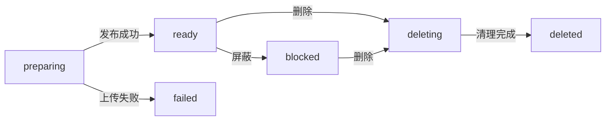

# 状态、任务与资源生命周期

上传返回链接后，副本写入和保存后处理可能仍在运行；发起删除后，远端对象也可能尚未清理。开发时需要区分三件事：文件是否可用、副本实际处于什么阶段、后台工作执行到哪里。

## 三组状态分别表示什么

| 对象 | 状态 | 表达的事实 |
| --- | --- | --- |
| 文件 | `preparing`、`ready`、`blocked`、`failed`、`deleting`、`deleted` | 上传未发布、可访问、被屏蔽、上传失败、待清理、已删除 |
| 副本 | `pending` → `writing` → `ready` | 一个存储源上的写入进度 |
| 副本 | `write_failed`、`write_unknown` | 写入失败，或无法确认远端结果 |
| 副本 | `delete_pending` → `deleting` → `deleted` | 一个存储源上的删除进度 |
| 副本 | `delete_failed`、`delete_unknown` | 删除失败，或无法确认远端结果 |
| 任务 | `pending`、`running`、`success`、`failed`、`cancelled` | 一次后台工作的调度与执行进度 |

任务类型有 `write`（副本写入）、`action`（保存后处理）、`delete`（删除副本）。文件 `ready` 不表示所有任务都已成功。

`unknown` 不等于对象不存在：请求中断时，远端操作可能已经完成。取消尚未写入的副本则直接记为 `deleted`，副本没有 `cancelled` 状态。

界面的 `DELETE_FAILED` 是根据删除任务等记录计算出的展示状态，不是数据库中的文件状态。

## 上传与删除如何推进

图中只展示主要路径。发布前失败不会产生正常可访问的文件；发布后，后台失败记录在对应任务或副本上，不能简单把整个文件改为上传失败。

删除先改变数据库状态，停止正常公开访问，再清理副本。删除失败需要保留可追踪的记录；用户选择放弃清理并移除记录后，远端残留对象不再由这些记录管理。

保存后流水线默认按 `delete > block > pass` 累计处置，步骤可通过 `overrideStatus` 显式覆盖。后续步骤失败不能丢失已经累计的处置；用户已经发起的删除也不能被插件结果撤回。协议细节见 [保存后处理插件](./processors/post-save.md)。

## 任务如何领取与重试

所有副本从首次写入起都有持久化任务，任务 ID 用作写入及恢复的操作标识。`core/tasks.ts` 在全局并发限制内优先为运行任务较少的文件派发工作，同等条件按到期时间及稳定 ID 排序。上传登记任务后立即调度，任务结束后补充空位；维护循环负责到期重试。

| 任务 | 允许领取时的文件状态 |
| --- | --- |
| `write` | `preparing` 时仅首次尝试；`ready`、`blocked` 时允许后续重试 |
| `action` | `ready` |
| `delete` | `ready`、`blocked`、`deleting` |

首次可用副本的结果提交后唤醒上传流程，由上传流程重新校验权限、配置及配额，并在事务内发布文件、消费一次配额、创建保存后任务。发布前所有目标首轮均失败则上传失败，不等待重试；发布后其余写入继续执行。

候选查询后，执行事务仍会复查状态。短锁保护任务领取和清理登记，不覆盖插件读写；同一文件进入清理期间，不再为它领取新任务。

自动重试取决于错误是否可重试、尝试次数与退避时间。手动重试删除任务只执行一次，次数持续累计，失败后不再自动重试。保存后任务已累计 `block/delete` 时，即使后续步骤失败也不再自动重试，不阻止相应清理。

## 重启恢复做什么

启动时，`bootstrap.ts` 调用文件与上传会话恢复：

- 中断的 `preparing` 文件转为失败并进入清理。
- 普通 `running` 任务重新进入待调度状态；被中断的单次手动重试记为失败。
- 恢复临时空间记账，检查未完成工作，清理失去归属的临时内容。

恢复不是无条件重做所有失败操作。任务执行仍需检查文件和副本的当前状态；远端写入结果不确定时，也不能假定“本地报错，所以远端没有对象”。相关实现位于 `core/files.ts`、`core/uploads.ts` 和 `persistence/repositories.ts` 的 `recoverTasks`。

## 资源何时释放

| 资源 | 保留与释放规则 |
| --- | --- |
| 上传临时内容 | 后台写入或保存后任务仍需要内容时保留；不再需要且在途使用结束后删除 |
| 临时空间预算 | 包含预留与实际使用；内容删除成功后才释放对应记账 |
| 派生缓存 | 由容量、保留时间和缓存清理管理，不承担原图持久化职责 |
| 响应流 | 返回 `Response` 不等于读取完成，资源需保留到流消费结束或取消 |
| 插件实例租约 | 调用期间持有，调用完成后释放，防止实例更新或关闭时提前释放资源 |

远端状态未知不要求无限保留本地临时内容，但仍在执行的读写不能提前释放资源。插件必须配合取消；同进程中的 `AbortSignal` 无法强制终止不响应取消的插件。相关约定见 [错误、取消与并发](./plugin-errors.md)。

## 备份与停机的顺序

两者都先阻止新工作，避免自动补充任务与关闭资源发生竞争。

| 场景 | 协调顺序 |
| --- | --- |
| 备份或恢复 | 进入维护状态 → 等待在途请求与维护工作 → 暂停任务领取 → 等待运行任务 → 关闭应用 → 备份或恢复 → 重新打开应用并恢复调度 |
| 停机 | 停止 HTTP 服务 → 停止维护循环 → 等待已有维护操作和在途工作 → 暂停领取 → 关闭业务服务、取消并等待剩余任务 → 释放插件、数据库和目录锁 |

备份期间可能重新创建应用，停机需要等待这段流程结束后再次暂停新应用的任务领取。调整调度时，应同时检查完成后的自动补充、备份入口和停机路径，不能只修改定时轮询。
