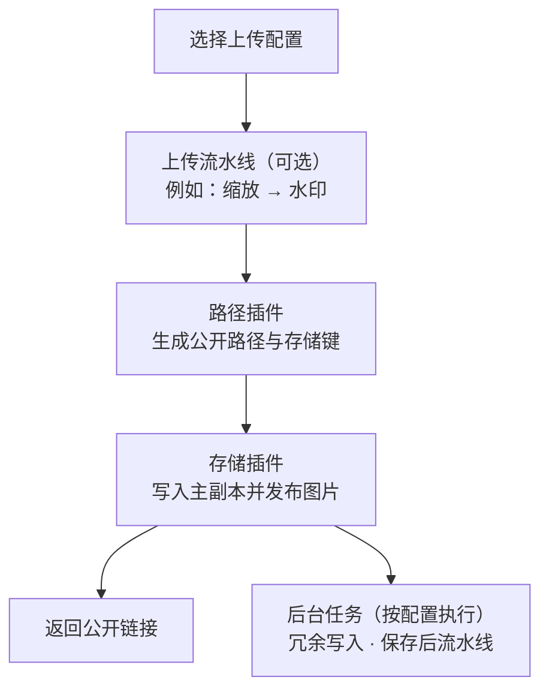
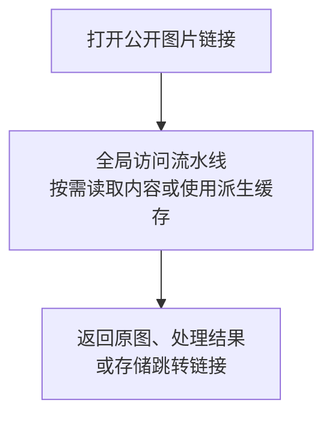

# 理解 Picloom

Picloom 通过插件提供能力，通过流水线安排处理步骤，再用上传配置把路径、存储和处理规则组合起来。理解这三层关系，就能知道每项设置应该放在哪里。

## 三类插件：分别负责什么

| 类型 | 职责 | 示例 | 在哪里配置 |
| --- | --- | --- | --- |
| 路径插件 | 生成图片的公开路径和存储键 | 随机路径、日期路径 | 上传配置中 |
| 存储插件 | 写入、读取和删除实际文件 | 本地存储、S3 兼容存储 | 存储源中 |
| 处理插件 | 修改图片，或执行审核、通知等操作 | 内置图片处理、水印、Telegram 通知；可选腾讯云内容审核 | 流水线的步骤中 |

插件提供能力，填写配置后才能使用。例如，S3 插件本身不代表某个桶；填入端点、桶和凭证后，才得到一个可以读写的**存储源**。同一个插件可以使用不同配置，连接多个桶或用于多个处理步骤。

内置插件随主程序提供；腾讯云审核、OpenList 等官方外部插件需要先[安装插件](./plugins.md)，再创建配置。

## 三类流水线：处理在什么时候发生

**流水线是按顺序执行的一组处理步骤，每个步骤使用一个处理插件。** 路径生成和存储读写由各自的插件负责，不作为流水线步骤添加。

| 流水线 | 执行时机 | 典型用途 | 作用范围 |
| --- | --- | --- | --- |
| 上传流水线 | 图片保存前 | 缩放后加水印，保存处理后的图片 | 由上传配置选择，可被多个配置共用 |
| 访问流水线 | 通过公开链接读取图片时 | 根据 URL 参数生成缩略图或转换格式 | 全局生效，也作用于已有图片 |
| 保存后流水线 | 图片发布后，在后台执行 | 内容审核、Telegram 通知 | 由上传配置选择，可被多个配置共用 |

处理插件会声明自己支持的阶段。例如，水印可以用于上传和访问，腾讯云内容审核用于保存后；并不是每个处理插件都能放进任意流水线。

步骤顺序会影响结果。例如“缩放 → 水印”先调整尺寸，再按新尺寸添加水印。没有处理需求时，上传和保存后流水线可以不选，访问流水线也可以不添加步骤。

## 上传配置：把这些能力组合成一个入口

配置存储时，先创建存储源，再将它们加入存储组。存储组决定主副本和冗余副本放在哪里；上传配置选择这个组，同时指定路径和处理规则。

以“博客图片”为例：

| 对象 | 示例配置 | 作用 |
| --- | --- | --- |
| 存储源 | 本地图片，根目录 `./images` | 提供一个实际存储位置 |
| 存储组 | 包含“本地图片”，冗余副本数 `0` | 将图片保存一份到本地 |
| 上传流水线 | 水印步骤，文字为 `example.com` | 给新上传的图片加水印 |
| 上传配置 | 名称“博客图片”，前缀 `/blog/`，随机路径，选择上述存储组和上传流水线 | 在上传页提供一个可选入口 |
| 全局访问流水线 | 图片处理，启用 `w` 和 `format` 参数 | 让公开链接支持缩略图和格式转换 |

上传者只需选择“博客图片”，不必每次重新选择存储位置或填写水印规则。需要另一套规则时，可以再建“截图”上传配置，共用存储组，但不选择水印流水线。

## 上传一张图片时发生了什么

上传成功表示**主副本已写入，图片已发布**。如果配置了冗余副本或保存后流水线，它们可能仍在执行，可在图片的操作详情中查看结果。

保存后审核可能随后屏蔽或删除图片。因此，它不能保证“审核通过后才首次公开”。

## 打开图片链接时发生了什么

以上述“博客图片”为例：

- 上传时添加的水印已经写入保存的图片，之后关闭上传流水线也不会移除它。
- 启用访问参数后，`?w=320&format=webp` 可以生成缩略图，不覆盖存储中的图片。
- 未启用的请求参数不会传给处理步骤。全局访问规则如何配置，见 [流水线](./pipelines.md)。

这里的“原图”指**上传处理后实际保存的图片**，不一定是最初选择的文件。图片管理中的一条文件记录可以对应多个存储副本，但共用一个公开路径；访问处理产生的派生缓存不算副本。

接下来可按 [快速开始](./quick-start.md) 建立第一套配置，或查看 [常见场景](./recipes.md) 中的水印、缩略图和多副本示例。
