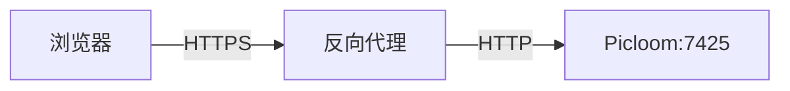

# 域名与反向代理

## 使用一个域名

管理页面、上传和图片访问可以共用 `https://pic.example.com`：



先将域名解析到服务器，并为反向代理准备该域名的 HTTPS 证书。下面以 Nginx 运行在 Picloom 所在宿主机上为例。

## 配置 Picloom

已有部署先在 **设置** 中将站点域名设为 `https://pic.example.com` 并保存。即使从未在 Web 点击过保存，首次启动也已经将运行设置写入 `site-settings.json`，之后修改 `.env` 的 `PUBLIC_ORIGIN` 不会覆盖它。

首次启动前，可在部署目录的 `.env` 中设置站点域名；同时限制宿主机端口只供本机代理访问：

```dotenv
PUBLIC_ORIGIN=https://pic.example.com
PUBLISH_ADDRESS=127.0.0.1
HTTP_PORT=7425
```

站点域名包含协议，不带路径和末尾斜杠。`127.0.0.1` 让应用端口仅供宿主机访问，对外通过 Nginx 提供服务。

在部署目录应用配置：

```sh
docker compose up -d
```

站点域名设为 HTTPS 后，登录 Cookie 会启用 `Secure` 属性。已有部署保存后应通过 HTTPS 重新登录。`PUBLISH_ADDRESS` 和 `HTTP_PORT` 属于部署参数，修改后仍需重建容器应用。

## 配置 Nginx

将以下配置放入 Nginx 的站点配置文件（由 `http` 块加载），替换域名及证书路径：

```nginx
server {
    listen 80;
    server_name pic.example.com;
    return 301 https://pic.example.com$request_uri;
}

server {
    listen 443 ssl;
    server_name pic.example.com;

    ssl_certificate /etc/nginx/certs/pic.example.com/fullchain.pem;
    ssl_certificate_key /etc/nginx/certs/pic.example.com/privkey.pem;
    ssl_protocols TLSv1.2 TLSv1.3;

    client_max_body_size 64m;

    location / {
        proxy_pass http://127.0.0.1:7425;
        proxy_set_header Host $host;
        proxy_set_header X-Forwarded-Proto $scheme;
        proxy_set_header X-Real-IP $remote_addr;
        proxy_read_timeout 180s;
    }
}
```

`64m` 限制的是单次请求体，适用于默认上传和分片大小。提高上传或分片限制、上传较大备份时，也要调整代理限制。`180s` 是读取上游响应时两次读取之间的超时，并非整个请求的总时长。指令说明见 [Nginx 代理文档](https://nginx.org/en/docs/http/ngx_http_proxy_module.html)。

检查配置，通过后重载：

```sh
sudo nginx -t && sudo nginx -s reload
```

如果 Nginx 运行在另一个容器中，应让两者加入同一 Docker 网络，并将上游改为 `http://picloom:7425`。容器中的 `127.0.0.1` 指向容器自身。

## 获取真实客户端 IP

游客每日额度等功能依赖客户端 IP。Picloom 仅在直连来源属于可信代理时读取 `X-Real-IP`，否则使用直连来源 IP。

在 Web「设置」的「游客上传」区域填写「可信代理」，每行一个 IPv4、IPv6 地址或 CIDR 网段，保存后立即生效；留空则不信任任何代理。代理必须覆盖 `X-Real-IP`，上面的 Nginx 示例已包含此配置。

如果应用入口受反向代理保护，且内部网络和容器均可信，可以填写全部私有 IPv4 网段，避免常规 Docker 网络重建后需要修改地址：

```text
10.0.0.0/8
172.16.0.0/12
192.168.0.0/16
```

这些网段内能直连 Picloom 的设备都可以提供客户端 IP。不符合上述条件时，请填写具体代理 IP 或专用网络 CIDR。环境变量 `TRUSTED_PROXIES` 使用逗号分隔，仅作为站点首次初始化或已有站点首次补入该字段时的值；之后通过 Web 修改。

如果前面还有 CDN，应先按 CDN 的官方说明，让 Nginx 仅信任该 CDN 的来源地址并还原客户端 IP，再转发给 Picloom。否则 `$remote_addr` 可能只是 CDN 节点地址。

## 单独使用图片域名（可选）

需要区分管理入口和图片链接时，在 **设置** 页面配置：

| 配置 | 示例 | 用途 |
| --- | --- | --- |
| 站点域名 | `https://pic.example.com` | 管理与上传入口 |
| 图片域名 | `https://img.example.com` | 生成图片链接 |

图片域名留空时跟随站点域名。后台通知没有浏览器请求上下文，需要绝对图片链接时，应配置站点域名或图片域名。

为图片域名单独配置解析、证书和反向代理，同样转发到 Picloom。填写该设置不会自动配置代理，也不会限制这个域名只能访问图片。

## CDN 与防盗链（可选）

CDN 按图片路径配置缓存，并遵循响应的 `Cache-Control`；管理页面、认证和上传 API 不要配置强制缓存。图片支持处理参数时，缓存键应保留查询参数，避免不同尺寸共用同一缓存。

浏览器/CDN 缓存时间在 **设置 → 缓存** 中调整。清空服务端派生缓存不会清除客户端缓存，删除或屏蔽图片后，已有缓存也可能继续展示。参数与行为见 [容量与并发](./resources.md#服务端缓存与客户端缓存)。

防盗链按 Referer 判断，支持精确域名、`*.example.com` 和是否允许空 Referer。它不等同于访问认证；CDN 命中缓存时不会经过 Picloom，若要在命中时也检查，需在 CDN 配置相应规则。

## 验证部署

- 通过 HTTPS 登录并上传一张图片。
- 检查复制出的图片链接是否使用预期域名，并能正常打开。
- 启用游客上传时，确认可信代理地址与实际来源一致，避免所有访客共用代理 IP 的额度。

遇到问题时，见 [故障排查](./troubleshooting.md)。
